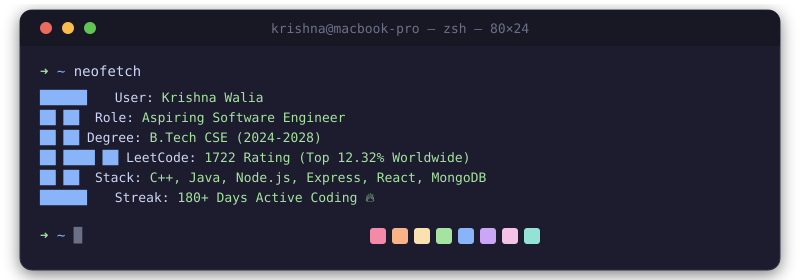

<!-- macOS-Style GitHub Profile README for Krishna Walia -->

<div align="center">

<picture>
  <source media="(prefers-color-scheme: dark)" srcset="assets/header-dark.svg">
  <source media="(prefers-color-scheme: light)" srcset="assets/header-light.svg">
  
</picture>

</div>

<br/>

<!-- ===== ABOUT ME TERMINAL WINDOW ===== -->
<div align="center">

```zsh
➜  ~ whoami
Krishna Walia — Aspiring Software Engineer & Competitive Programmer

➜  ~ cat bio.txt
> Strong foundation in Data Structures & Algorithms.
> Currently expanding expertise in Backend Development & Full-Stack Web Architecture.
> Passionate about building robust, scalable applications and writing clean code.

➜  ~ cat stats.json
{
  "education": "B.Tech CSE (2024-2028) @ CGC University Mohali (CGPA: 8.6)",
  "leetCodeRating": "1722 (Top 12.32% Worldwide)",
  "leetCodeStreak": "180+ Days Active Coding 🔥"
}
```

</div>

---

<!-- ===== TECH STACK ===== -->
<div align="center">

### 🛠️ Tech Stack & CS Fundamentals

#### Languages & Core CS


#### Web Development & Databases


#### Developer Tools


```zsh
➜  ~ cs_concepts --list
[✓] Data Structures & Algorithms    [✓] Object-Oriented Programming (OOP)
[✓] Database Management (DBMS)      [✓] Operating Systems
[✓] Computer Architecture           [✓] C++ STL & JDBC Architecture
```

</div>

---

<!-- ===== FEATURED PROJECTS ===== -->
<div align="center">

### 📂 Featured Projects

</div>

| Project | Tech Stack | Highlights |
| :--- | :--- | :--- |
| ✍️ **[MegaBlog — Full-Stack Platform](https://mega-blog1.vercel.app/)** | `React.js` `Appwrite` `Redux Toolkit` `Tailwind CSS` | • Responsive content publishing platform with full CRUD functionality.<br/>• Appwrite BaaS for Auth, Database, and Cover Image storage.<br/>• Global state via Redux Toolkit & rich-text editor via TinyMCE. |
| 🔑 **[Secure Auth Backend](https://github.com/krishna-walia-2006)** | `Node.js` `Express.js` `MongoDB` `JWT` `Bcrypt` `Nodemailer` | • Complete backend with JWT session tokens & password hashing.<br/>• Email verification via Nodemailer/Mailtrap & HTTP-only cookies.<br/>• CORS-enabled security for cross-origin requests. |
| 🏫 **[ClubHub — Management System](https://github.com/krishna-walia-2006)** | `Java 17` `AWT/Swing` `MySQL` `JDBC` | • 3-layer architecture (`UI` → `DAO` → `Database`).<br/>• Uses `PreparedStatements` to prevent SQL injection attacks.<br/>• Automatic first-run DB setup with junction tables for many-to-many relationships. |

---

<!-- ===== ACHIEVEMENTS & CERTIFICATIONS ===== -->
<div align="center">

### 🏆 Achievements & Certifications

```zsh
➜  ~ cat achievements.txt
🏆 LeetCode Rating: 1722 (Top 12.32% worldwide)
🔥 180+ Day LeetCode Streak — Disciplined daily algorithmic problem solving
🚀 Active Hackathon Participant — Building practical solutions under pressure

➜  ~ ls certifications/
📜 Programming Fundamentals using Python – Part 1 (Infosys Springboard)
📜 Java Programming Fundamentals (Infosys Springboard)
```

</div>

---

<!-- ===== GITHUB STATS ===== -->
<div align="center">

### 📊 GitHub & Competitive Programming Stats

<a href="https://github.com/krishna-walia-2006">
  
  
</a>

<br/>

<a href="https://github.com/krishna-walia-2006">
  
</a>

</div>

---

<!-- ===== CONNECT WITH ME ===== -->
<div align="center">

### 🤝 Connect & Collaborate

[](https://linkedin.com/in/krish2006)
[](https://github.com/krishna-walia-2006)
[](mailto:krishnawalia77@gmail.com)

<br/>


<br/><br/>

*Designed with 💻 & ☕ inspired by macOS Terminal Aesthetics*

</div>
